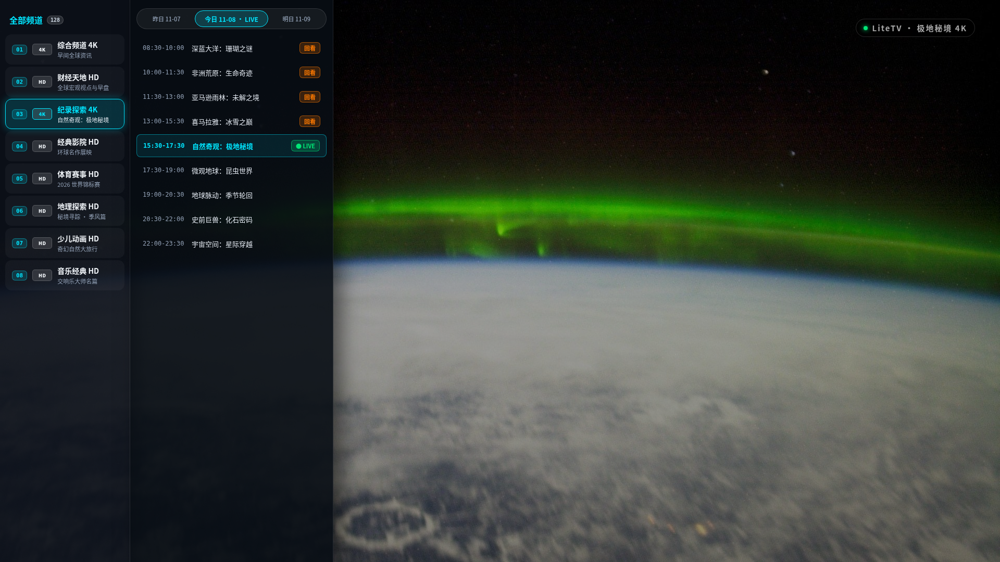
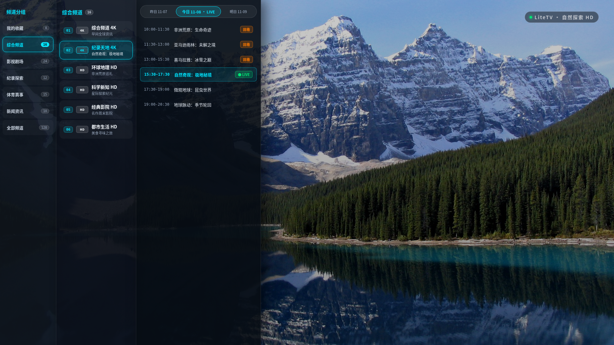
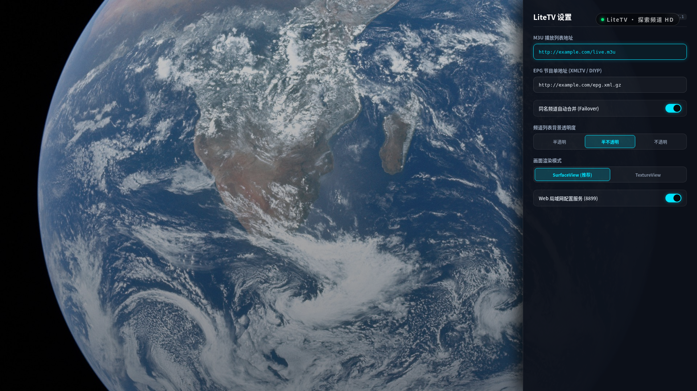

# 📺 LiteTV — 通用 IPTV 直播播放器

[](https://github.com/vibe4free/LiteTV/releases)
-4CAF50)


> GitHub 仓库：[github.com/vibe4free/LiteTV](https://github.com/vibe4free/LiteTV)

一款为 Android TV 遥控器深度优化、并支持手机触屏的**通用 IPTV 直播播放器（空壳应用）**。自身不含任何直播源，配置你的 M3U 直播源地址后即可使用；支持 **EPG 电子节目单**、**回看（时移）**、**频道分组与收藏**、**本地 M3U 文件导入**、**内置 Web 远程配置服务器**。

> 轻量设计：仅 Media3 (ExoPlayer) + HTTP，无 ijkplayer、无 P2P、无广告，按 ABI 拆分后约 3.3 MB / 个。

---

## ✨ 功能简介

### 核心定位
- **通用 IPTV 播放器（空壳）**：配置直播源后使用，支持 M3U / TXT 播放列表（网络地址或本地文件）
- **支持 EPG 电子节目单**：XMLTV（含 gzip/zip 压缩）、DIYP JSON 多格式，M3U 内置 EPG 自动识别
- **支持回看（时移）**：识别播放列表中 `catchup` 属性，可从节目单直接回看过去的节目

### 🎮 遥控器操作
| 按键 | 功能 |
|------|------|
| D-Pad **UP / DOWN** | 切换频道（频道列表打开时导航分组/频道/节目列表） |
| D-Pad **LEFT / RIGHT** | **全屏**时移动播放位置：单击 ±10 秒，长按加速（每秒 2 / 3 / 4 步，每步 10 秒，到 4x 后保持）；直播中按左键即从**当前时刻**回退进入回看。**列表打开时一律归列表**（切换焦点栏、节目栏翻日），回看中也不例外 |
| **OK（短按）** | 显示 / 隐藏频道列表 |
| **OK（长按）** | 全屏：回看当前节目；节目栏：回看选中节目；频道栏：收藏 / 取消收藏 |
| 数字键 **0-9** | 数字直达频道（2 秒输入窗口 + 顶部名称提示） |
| **音量键 ±** | 音量减 / 加 |
| **MENU** | 打开 / 收起右侧设置面板（面板内播放不中断；节目单展开时第一次 MENU 只关闭节目单） |
| **BACK** | 关闭设置面板 / 退出输入态 / 隐藏列表 / 取消数字输入 / 回看中返回直播 / 退出（弹确认框） |

### 📱 手机 / 触屏操作
- **沉浸式全屏**：自动隐藏状态栏与导航栏（播放页与设置页）
- 点按画面：呼出 / 收起控制条（底部信息条 + 时移条）；列表已打开时则收起列表
- 点按底部信息条：打开频道列表
- 上下滑动：切换频道；左右滑动：等同 LEFT/RIGHT（直播进入回看 / 回看快进快退 / 节目栏翻日）
- 双击画面：切换播放源（源 1/2/…）；长按画面：回看当前节目
- 频道列表三栏的行均可直接点击（分组 → 进入分组，频道 → 播放，节目 → 回看）

### 📺 播放体验
- **画面输出默认 SurfaceView**：视频走硬件视频层（含硬件去隔行/缩放），1080i 直播不再出现锯齿/模糊；部分设备异常时可在设置切回 TextureView
- **缓冲策略**：1.5s 起播（换台快）+ 12s 缓冲余量 + 1.5s 抗抖动恢复阈值
- **帧率匹配**：Android 11+ 上请求电视刷新率跟随片源，减少抖动
- **解码方式可选**：自动 / 仅硬件 / 优先软件（个别频道硬解不支持时用软解兜底）
- **无缝频道切换**：重用播放器实例（`switchUrl`），切换不重建连接
- **手动切换源**：一个频道有多个地址时，双击画面或按 **R** 键切到下一个源（与自动 failover 共用同一源列表）
- **可拖动时移条**：点按画面呼出，直播中拖动即进入回看；回看中拖动定位，并可一键「回到直播」
- **断流自动重连**：指数退避重试（1/2/4/8/15s），带播放状态提示与最终失败提示
- **多源 Failover**：一个频道多个地址（M3U 多条地址行，或 TXT 的 `url1#url2`）逐个尝试，失败自动切换
- **每频道自定义请求头**：支持 `http-user-agent`、`http-referrer`、`#EXTVLCOPT`、`url|User-Agent=...&Referer=...` 后缀
- **重启恢复**：自动续播上次观看的频道

### 🗂️ 频道管理
- M3U 解析：分组（`group-title`）、台标（`tvg-logo`）、频道 ID（`tvg-id`）、多源、UA/Referer
- **本地 M3U 文件**：在设置中选择 U 盘 / 内置存储中的 `.m3u` 文件直接导入（系统文件选择器，无需存储权限），文件会拷贝到应用私有目录，拔掉 U 盘也不影响使用；设置后优先于网络地址，可在设置或 Web 页面中随时移除
- **无文件选择器的电视 / 盒子**：设置页提供「从文件夹导入」（扫描投放目录、Download 及 U 盘卷，列出找到的 `.m3u`/`.txt` 文件供选择），或在 **Web 配置页直接上传 M3U 文件**（手机 / 电脑选文件，电视端自动重新加载）。投放目录路径会显示在设置页与 Web 配置页；Android 11+ 可一键跳转系统设置授予「所有文件访问权限」以让该目录（`/sdcard/LiteTV`）可写（issue #7）
- **分组导航**：内置「我的收藏」「全部频道」+ 播放列表自带分组；**重开列表保持你上次选的分组**
- **同名频道自动合并**：订阅链接把同一频道按源重复列出时（如央视一套出现 5 次），自动合并为一个频道、5 个源依次尝试（可在设置关闭；播放界面按 R 或双击切源）
- **收藏频道**：频道列表频道栏长按 OK 标记 / 取消（按频道名保存，刷新后依然有效）
- **播放列表磁盘缓存**：网络故障时自动使用缓存播放

### 📅 EPG 电子节目单
- **多格式支持**：XMLTV（gzip/zip 自动解压）、DIYP JSON，自动格式检测
- **高效解析**：流式解析（XmlPullParser）、单次批量解析全频道、302 重定向跟随
- **本地缓存**：磁盘缓存 + 按日期校验 + 版本控制，启动预加载秒开
- **节目展示**：当前节目 / 下一个节目、实时进度条、频道列表内嵌节目表；**高亮行的过长名称自动滚动**（跑马灯），其余行显示省略号
- **7 天滚动节目单**：缓存保留最近 7 天（含次日）；打开时自动定位到**正在播出（回看时则是正在回放）的那个节目**；节目栏 **LEFT / RIGHT** 翻前 / 后一天（没有更早数据时 LEFT 折回频道栏），在列表**顶 / 底再按 UP / DOWN** 也可翻日（向上越顶继续前一天的末尾）
  （今日 / 昨日 / 具体日期标题），选中过去日期的节目即可回看
  - 说明：EPG 源（51zmt / 112114 等）只提供“今 + 明日”，历史天数随每天抓取逐步积累（与 TiviMate 一致）
- **安全加固**：禁用外部实体解析（XXE 防护）
- **M3U 内置 EPG**：自动识别播放列表头部的 `x-tvg-url` / `tvg-url` / `url-tvg` 属性
  （TiviMate / IPTVnator / Kodi 等通用约定，支持空格或 `|` 分隔的多个后备地址，仅接受 http/https）
- **来源优先级**：未配置 EPG 时自动使用 M3U 内置 EPG；已配置时可选择「自动 / 优先 M3U 内置 / 仅用户配置」

### ⏪ 回看（Catchup / 时移）
- 自动识别播放列表中的 `catchup` / `catchup-source` / `catchup-replace` 属性
  （TiviMate / IPTV Smarters / rtp2httpd 等通用约定），支持 `default` / `append` 两种模式
- 时间占位符：`${(b)yyyyMMddHHmmss}` / `${(e)yyyyMMddHHmmss}`（本地时间）、
  `${utc}` / `${utcend}`（Unix 秒）、`${start:格式}` / `${end:格式}`、`${timestamp}`、`{duration}` 等
- 触发方式：**直播中按 LEFT** 从**当前时刻**回退 10 秒进入回看（不再跳到节目开头）；**节目栏短按 / 长按 OK** 回看选中节目；**全屏长按 OK** 回看当前节目
- 回看中 **LEFT/RIGHT** 单击 ±10 秒、长按加速（每秒 2 / 3 / 4 步，每步 10 秒，封顶 4x），也可拖点时移条定位；**BACK** 或「回到直播」按钮返回直播，播完 / 出错自动回到直播
- **回看窗口可跨节目**：滑到当前节目开头后继续按左键会进入上一个节目（窗口回退到节目单中最早可用的节目，最长 3 小时）
- 时移条为**单轨**设计：EPG 节目分段按深浅区分，当前节目高亮为主色，白色竖线是唯一播放位置标记，右端为直播边缘
- 回看时画面左下角显示**回放标记**（可在设置 → 显示中关闭），提示当前不是直播
- 仅接受 http/https 回看地址，安全解析

### 🌐 内置 Web 配置服务器（局域网远程配置）
- Socket HTTP 服务器，零外部依赖，默认端口 **8899**
- 浏览器打开 `http://电视IP:8899` 即可可视化配置
- 与电视端设置面板**可配置项一致**：M3U 地址 / 本地文件（上传或移除）/ 合并同名频道 / EPG 地址 / EPG 来源优先级 / EPG 显示开关 / 回放标记开关 / 菜单透明度 / 画面输出方式 / 解码方式 / 视频直通
  （本地文件只能上传或移除，不能浏览电视文件系统；Web 服务器端口不可在页面内修改）
- REST 接口：`GET /config/get`、`POST /config/m3u-url`、`POST /config/epg-url`、`POST /config/epg-preference`、`POST /config/m3u-file-clear`、`POST /config/m3u-file-upload`（multipart 上传 M3U）、`POST /config/playback`、`POST /config/display`
- 安全加固：跨站请求防护（Origin 校验）、请求体上限、超时、有界线程池

### ⚙️ 设置项
- M3U 直播源地址、**本地 M3U 文件导入（U 盘 / 内部存储）**、EPG 地址、EPG 来源优先级（自动 / 优先 M3U 内置 / 仅用户配置）
- **播放设置**（需重启应用生效）：画面输出（SurfaceView 推荐 / TextureView 兼容备用）、解码方式（自动 / 仅硬件 / 优先软件解码）、视频直通显示（实验）
- Web 服务器开关（端口固定 8899，设置页会显示本机访问地址）
- EPG 显示开关、菜单栏透明度（淡 / 中 / 实心）
- 配置通过 Hawk（加密）持久化

---

## 📸 截图

### 频道节目列表
频道列表（左侧）+ 节目单（右侧），高亮当前频道，节目单展示当前 / 下个节目与时间：



### 频道节目列表与频道分组
左侧分组栏（我的收藏 / 全部频道 / 各直播源分组），支持分组快速定位：



### 配置界面
设置页（MENU 键打开）：



---

## 📦 安装下载

### 系统要求
- **Android TV / Google TV** 或支持 Leanback 的 Android 设备（**Android 5.1+，API 21+**）
- 内存建议 ≥ 512MB，支持硬件解码

### GitHub Release 下载

从 **[GitHub Releases](https://github.com/vibe4free/LiteTV/releases) 页面下载最新版 APK**（`LiteTV-vX.Y.Z.apk`），拷贝到设备后直接安装。

```bash
# 或用 ADB 安装（USB / 局域网）
adb install -r LiteTV-vX.Y.Z.apk
```

> Release 版已启用代码混淆（R8）与资源压缩，APK 体积更小。

---

## 🚀 快速开始

1. **准备直播源**：一份 M3U 播放列表，例如
   ```
   #EXTM3U
   #EXTINF:-1 tvg-id="1" tvg-name="CCTV1" tvg-logo="http://.../CCTV1.png" group-title="央视",CCTV1
   http://你的直播服务器/CCTV/CCTV1
   ```
2. **按 MENU 打开设置**，填入 M3U 地址并保存（例如 `http://example.com/playlist.m3u`）
   > 也可以把 `.m3u` 文件放到 U 盘上，在设置中点「选择 M3U 文件」直接导入本地文件
3. **可选**：填入 EPG 地址（XMLTV 或 DIYP JSON，如 `http://epg.example.com/e.xml.gz`）；如果播放列表头部自带 `x-tvg-url`，不填也会自动使用
4. **返回播放界面**，频道自动加载并开始播放第一个频道
5. 按 **OK** 打开频道列表，**UP/DOWN** 换台，**数字键**直达频道；有回看的频道直接按 **LEFT** 即可时移回看

> 也可以直接用手机/电脑浏览器访问 `http://电视IP:8899` 完成上述配置。

---

## 🙏 致谢

本项目在开发与测试过程中受到以下开源项目的启发与帮助：

- [**rtp2httpd**](https://github.com/stackia/rtp2httpd) — RTP 流转 HTTP 工具，项目的直播源思路与测试基础
- [**ExoPlayer / AndroidX Media3**](https://github.com/androidx/media) — 强大的 Android 媒体播放器框架，本项目的播放核心（Media3 1.4.1，仍是支持 minSdk 21 的版本线）

---

## ⚠️ 免责声明

本项目为通用播放器工具，不提供任何直播源。请仅配置你拥有合法播放权限的内容源，遵守当地法律法规及内容版权规定。
